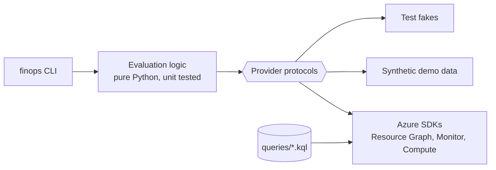

# cloud-finops-toolkit

**Find the Azure spend nobody is using, and act on it safely.**

[](https://github.com/marlyngiselle/cloud-finops-toolkit/actions/workflows/ci.yml)


A small, tested Python CLI that turns the usual FinOps levers (clean-up of orphaned resources, tagging governance, rightsizing, auto-shutdown and Azure Hybrid Benefit) into repeatable reports and guarded actions. It reads your estate through Azure Resource Graph and Azure Monitor, and changes nothing unless you explicitly ask it to.

---

## The problem

Cloud waste rarely comes from one big mistake. It comes from hundreds of small leftovers:

- a disk detached during a migration and never deleted,
- a public IP kept "just in case",
- a dev VM running all weekend,
- a VM shut down from inside Windows, which still bills compute,
- a server sized for a launch peak that never came back,
- Windows and SQL licenses paid by the hour while the company already owns them.

Each one is cheap to fix once found. The hard part is finding them across every subscription, knowing who owns them, and fixing them without breaking anything. That is what this toolkit does.

## What it finds

| Command | Finds | Data source | Changes anything? |
| --- | --- | --- | --- |
| `finops idle` | Unattached managed disks, unassociated public IPs, orphaned NICs, empty App Service plans, VMs stopped but not deallocated | Resource Graph | No |
| `finops tags` | Resources and resource groups breaking a required-tags policy (missing, empty, value not allowed, pattern mismatch, key case) | Resource Graph + YAML policy | No |
| `finops rightsize` | Running VMs whose CPU and memory percentiles fit a smaller size, or that are near-idle | Resource Graph + Azure Monitor | No |
| `finops hybrid-benefit` | Windows VMs, SQL Server VMs, SQL Database, elastic pools and Managed Instances paying for licenses | Resource Graph | No |
| `finops schedule` | Applies or removes an auto-shutdown tag convention, and runs the shutdown handler | Resource Graph + Compute API | Only with `--apply` |

Every query is a reviewable `.kql` file in [`queries/`](queries/). Resources tagged `finops-ignore=true` are left out of every report.

## Install

Requires Python 3.11 or newer.

```bash
git clone https://github.com/marlyngiselle/cloud-finops-toolkit.git
cd cloud-finops-toolkit
python3 -m venv .venv && source .venv/bin/activate
pip install -e .
```

Authentication uses [`DefaultAzureCredential`](https://learn.microsoft.com/python/api/azure-identity/azure.identity.defaultazurecredential): run `az login` locally, or use a managed identity or workload identity in automation.

## Quick start

Try every command without an Azure account. `--demo` swaps in bundled synthetic data:

```console
$ finops --demo idle
CATEGORY                NAME                  RESOURCE_GROUP  LOCATION    DETAIL                                                 AGE_DAYS
----------------------  --------------------  --------------  ----------  -----------------------------------------------------  --------
unattached-disk         disk-build-agent-old  rg-ci-dev       westeurope  256 GiB Premium_LRS                                    96
unattached-disk         disk-sqltest-data02   rg-data-test    westeurope  512 GiB StandardSSD_LRS                                41
unattached-disk         disk-temp-restore     rg-shop-dev     westeurope  128 GiB Standard_LRS                                   3
unassociated-public-ip  pip-old-appgw         rg-shop-prod    westeurope  Standard SKU, Static, 203.0.113.10
unassociated-public-ip  pip-vm-jump-01        rg-shop-dev     westeurope  Standard SKU, Static, 198.51.100.24
orphaned-nic            nic-etl-old-7731      rg-data-test    westeurope  not attached, private IP 10.30.2.9
orphaned-nic            nic-vm-jump-01        rg-shop-dev     westeurope  not attached, private IP 10.20.1.4, holds a public IP
empty-app-service-plan  asp-shop-staging      rg-shop-dev     westeurope  P1v3 (PremiumV3), 2 instance(s), 0 apps
stopped-vm              vm-report-batch       rg-data-test    westeurope  Standard_E8s_v5 stopped but still allocated

9 finding(s). empty-app-service-plan: 1, orphaned-nic: 2, stopped-vm: 1, unassociated-public-ip: 2, unattached-disk: 3
```

```console
$ finops --demo rightsize
NAME               RESOURCE_GROUP  VM_SIZE           CPU_P95  MEM_P95  VERDICT   SUGGESTED_SIZE   NOTE
-----------------  --------------  ----------------  -------  -------  --------  ---------------  ----------------------------------------------------------------
vm-build-agent-02  rg-ci-dev       Standard_F16s_v2  2.7      11.9     idle                       near-idle: consider a shutdown schedule or decommissioning
vm-jump-01         rg-shop-dev     Standard_B4ms     8.0               downsize  Standard_B2ms    check regional availability before resizing; memory not measured
vm-shop-web-01     rg-shop-prod    Standard_D8s_v5   12.9     30.8     downsize  Standard_D4s_v5  check regional availability before resizing

6 running VM(s) evaluated over 14 days. downsize: 2, idle: 1, insufficient-data: 1, keep: 2
```

```console
$ finops --demo schedule run --at 2026-10-27T18:10:00Z
Evaluated at 2026-10-27T18:10+00:00

NAME             RESOURCE_GROUP  ACTION      OUTCOME              DETAIL
---------------  --------------  ----------  -------------------  -----------------------------------
vm-shop-dev-01   rg-shop-dev     deallocate  dry-run              19:00 Europe/Paris mon-fri
vm-ci-agent-03   rg-ci-dev       none        invalid-schedule     time must be HH:MM (24h), got '7pm'
vm-data-test-01  rg-data-test    none        already-deallocated  20:00 America/New_York mon-fri
vm-shop-dev-02   rg-shop-dev     none        skipped              skip-until 2026-10-31

Dry run: nothing was changed. Re-run with --apply to make these changes.
```

All outputs, including `tags` and `hybrid-benefit`, CSV and JSON, are in [docs/sample-outputs.md](docs/sample-outputs.md). All names and IDs there are synthetic.

### Against your estate

```bash
# Everything the signed-in identity can read
finops idle

# Two subscriptions, disks detached for at least 30 days, as CSV for a spreadsheet
finops idle -s <subscription-id> -s <subscription-id> -c unattached-disk --min-age-days 30 -f csv -o idle.csv

# Tag compliance, failing a pipeline when anything is non-compliant
finops tags --policy examples/tag-policy.yaml --fail-on-violations

# 30 days of metrics, p95, downsize when CPU < 25% and memory < 50%
finops rightsize --lookback-days 30 --cpu-threshold 25 --memory-threshold 50 -f json

# Hybrid Benefit gaps on SQL only
finops hybrid-benefit -w sql-vm -w sql-database -w sql-managed-instance

# Preview, then apply, a 19:00 Paris shutdown on every VM tagged environment=dev
finops schedule apply --time 19:00 --tz Europe/Paris --days mon-fri --tag environment=dev
finops schedule apply --time 19:00 --tz Europe/Paris --days mon-fri --tag environment=dev --apply
```

Output formats: `table` (default), `csv`, `json`. CSV and JSON include full resource IDs and the recommended action; the table keeps to what fits a terminal.

## Permissions

Grant the least privilege for what you run, at the management group or subscription scope you want to cover.

| Command | Role |
| --- | --- |
| `idle`, `tags`, `hybrid-benefit` | `Reader` |
| `rightsize` | `Reader` + `Monitoring Reader` |
| `schedule apply/remove/run` (dry-run) | `Reader` |
| `schedule apply/remove/run --apply`, timer handler | `Virtual Machine Contributor`, only on the scopes it manages |

Resource Graph only returns what the identity can read, so a narrow role assignment also limits the report. If a resource you expect is missing, check the identity's scope before concluding it does not exist.

## Safety

- **Read-only by default.** Only `schedule` can change anything, and only with `--apply`. The timer handler stays in dry-run unless `FINOPS_DRY_RUN=false`.
- **No delete, no resize.** Those remain decisions for resource owners through their change process. The toolkit reports and recommends.
- **No accidental blast radius.** `schedule apply/remove` refuses to run without a selector (`--resource-group`, `--name`, `--tag`) or an explicit `--all-vms`.
- **Opt-outs are first-class.** `finops-ignore=true` hides a resource from reports; `finops-shutdown-skip-until=YYYY-MM-DD` pauses a schedule, and re-applying a schedule keeps it.
- **Failures are isolated.** One VM failing to deallocate is logged and the run continues; the exit code reports the failure.
- **Tag merges are additive.** Applying a schedule rewrites only the `finops-shutdown-*` tags and keeps every other tag.

## Configuration

### Tag policy

```yaml
required_tags:
  - name: owner
    pattern: '^[^@\s]+@example\.com$'
  - name: cost-center
    pattern: '^CC-\d{4}$'
  - name: environment
    allowed: [dev, test, prod]
  - name: application
case_sensitive_keys: false
inherit_from_resource_group: true
exclude_types:
  - microsoft.network/networkwatchers
```

Full example: [`examples/tag-policy.yaml`](examples/tag-policy.yaml).

### Auto-shutdown tags

| Tag | Example | Default |
| --- | --- | --- |
| `finops-shutdown-time` | `19:00` | required, enables the schedule |
| `finops-shutdown-tz` | `Europe/Paris` | `UTC` |
| `finops-shutdown-days` | `mon-fri`, `daily`, `sat,sun` | `mon-fri` |
| `finops-shutdown-skip-until` | `2026-11-15` | none |

The handler (`python -m finops.handler`, or the [Azure Function example](examples/azure-function/)) runs on a timer, converts each VM's local time to UTC (daylight saving included) and deallocates VMs inside the shutdown window, including VMs stopped from the guest OS that are still billed.

## How it works



Commands depend on three small protocols, not on Azure SDK clients. Production wires in the Azure implementations; tests and `--demo` wire in in-memory fakes. Details, decision flows and diagrams: [docs/how-it-works.md](docs/how-it-works.md).

## From findings to savings

A report is the start. [docs/finops-playbook.md](docs/finops-playbook.md) covers the operating model: making ownership visible with tags, routing findings to owners, approvals and exemptions, shutdown windows, rightsizing in production, and when Hybrid Benefit, reservations and savings plans make sense (after the clean-up, not before).

## Development

```bash
make install     # venv + editable install with dev tools
make check       # ruff, mypy --strict, pytest with coverage
make demo        # run every command on synthetic data
```

CI runs the same checks on Python 3.11 and 3.12 with pinned actions ([`.github/workflows/ci.yml`](.github/workflows/ci.yml)).

```text
src/finops/
  cli.py              typer CLI
  idle.py             idle and orphaned resources
  tags.py             tag policy model and evaluation
  rightsize.py        percentiles, verdicts, size suggestions
  hybrid_benefit.py   license evaluation
  schedule.py         shutdown tag convention, due-time logic, actions
  handler.py          timer entry point for scheduled shutdown
  output.py           table, CSV and JSON rendering
  providers/          protocols, Azure SDK adapters, synthetic demo data
queries/              Resource Graph queries (.kql), documented
tests/                pytest suite with in-memory fakes, no network
docs/                 architecture, FinOps playbook, sample outputs
examples/             tag policy, Azure Function timer
```

## License

[MIT](LICENSE) © 2026 Giselle Da Costa
