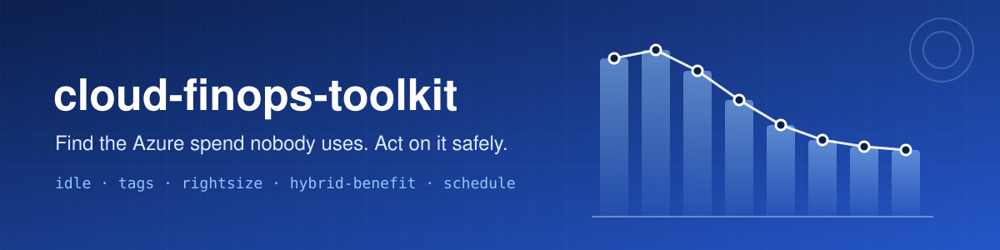
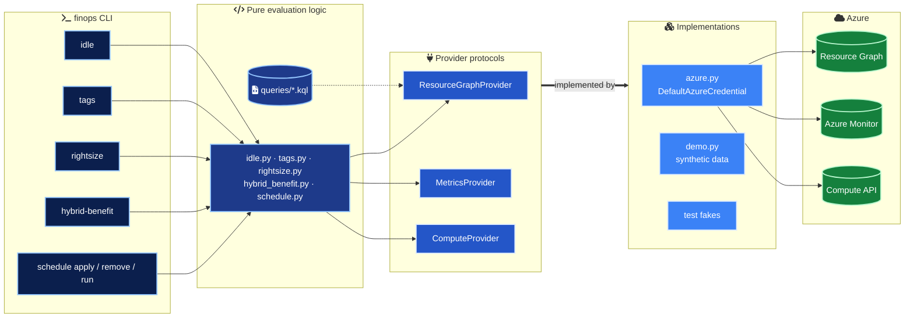
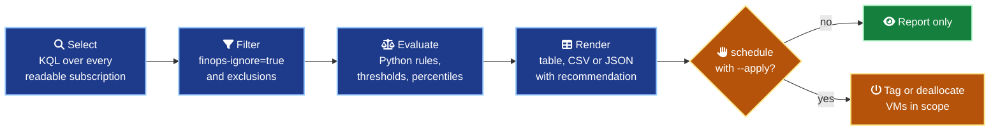
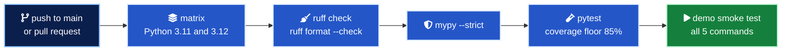

<div align="center">



<h3>Find the Azure spend nobody is using, and act on it safely.</h3>


</div>

---

## In numbers

| | |
| --- | --- |
| 5 | Commands (`idle`, `tags`, `rightsize`, `hybrid-benefit`, `schedule` with `apply`, `remove` and `run`) |
| 11 | Azure Resource Graph queries, each a reviewable `.kql` file |
| 5 | Idle resource categories, 5 tag violation types, 5 Hybrid Benefit workloads |
| 190 | Tests, no network, run in about one second |
| 98.6% | Branch coverage (CI floor 85%, the thin Azure SDK adapter is excluded) |
| 1 | Command that can change anything, and only with `--apply` |
| 3 | Output formats (`table`, `csv`, `json`) |
| 0 | Azure accounts needed to try it (`--demo` ships synthetic data) |

## What it is

Cloud waste rarely comes from one big mistake. It comes from hundreds of small leftovers, like a disk detached during a migration, a public IP kept just in case, a dev VM running all weekend, a VM stopped from inside Windows that still bills compute, or SQL licenses paid by the hour while the company already owns them.

`finops` is a small, typed and tested Python CLI that finds those leftovers across every subscription you can read, names the owner, and recommends the next step. It reads the estate through Azure Resource Graph and Azure Monitor and changes nothing unless you explicitly ask it to. It is built for platform and cloud teams who want FinOps as a repeatable report, not a one-off spreadsheet.

## Architecture



Commands depend on three small protocols, not on Azure SDK clients. Production wires in the Azure implementations, while tests and `--demo` wire in in-memory fakes. That is why every rule is unit tested without a network connection.

## How a report is built



Resource Graph is excellent at selecting candidates across thousands of resources in one call and a poor place for business rules that need tests and exceptions. So the `.kql` files select broadly and Python decides.

## Quick start

Requires Python 3.11 or newer. Try every command without an Azure account, since `--demo` swaps in bundled synthetic data.

```bash
git clone https://github.com/marlyngiselle/cloud-finops-toolkit.git
cd cloud-finops-toolkit
python3 -m venv .venv && source .venv/bin/activate
pip install -e .

finops --demo idle
finops --demo tags --policy examples/tag-policy.yaml
finops --demo rightsize
finops --demo hybrid-benefit
finops --demo schedule run --at 2026-10-27T18:10:00Z
```

<details>
<summary>Sample output of <code>finops --demo idle</code></summary>

```console
$ finops --demo idle
CATEGORY                NAME                  RESOURCE_GROUP  LOCATION    DETAIL                                                 AGE_DAYS
----------------------  --------------------  --------------  ----------  -----------------------------------------------------  --------
unattached-disk         disk-build-agent-old  rg-ci-dev       westeurope  256 GiB Premium_LRS                                    96
unattached-disk         disk-sqltest-data02   rg-data-test    westeurope  512 GiB StandardSSD_LRS                                41
unattached-disk         disk-temp-restore     rg-shop-dev     westeurope  128 GiB Standard_LRS                                   3
unassociated-public-ip  pip-old-appgw         rg-shop-prod    westeurope  Standard SKU, Static, 203.0.113.10
unassociated-public-ip  pip-vm-jump-01        rg-shop-dev     westeurope  Standard SKU, Static, 198.51.100.24
orphaned-nic            nic-etl-old-7731      rg-data-test    westeurope  not attached, private IP 10.30.2.9
orphaned-nic            nic-vm-jump-01        rg-shop-dev     westeurope  not attached, private IP 10.20.1.4, holds a public IP
empty-app-service-plan  asp-shop-staging      rg-shop-dev     westeurope  P1v3 (PremiumV3), 2 instance(s), 0 apps
stopped-vm              vm-report-batch       rg-data-test    westeurope  Standard_E8s_v5 stopped but still allocated

9 finding(s). empty-app-service-plan: 1, orphaned-nic: 2, stopped-vm: 1, unassociated-public-ip: 2, unattached-disk: 3
```

</details>

<details>
<summary>Sample output of <code>finops --demo rightsize</code></summary>

```console
$ finops --demo rightsize
NAME               RESOURCE_GROUP  VM_SIZE           CPU_P95  MEM_P95  VERDICT   SUGGESTED_SIZE   NOTE
-----------------  --------------  ----------------  -------  -------  --------  ---------------  ----------------------------------------------------------------
vm-build-agent-02  rg-ci-dev       Standard_F16s_v2  2.7      11.9     idle                       near-idle: consider a shutdown schedule or decommissioning
vm-jump-01         rg-shop-dev     Standard_B4ms     8.0               downsize  Standard_B2ms    check regional availability before resizing; memory not measured
vm-shop-web-01     rg-shop-prod    Standard_D8s_v5   12.9     30.8     downsize  Standard_D4s_v5  check regional availability before resizing

6 running VM(s) evaluated over 14 days. downsize: 2, idle: 1, insufficient-data: 1, keep: 2
```

</details>

<details>
<summary>Sample output of <code>finops --demo schedule run</code></summary>

```console
$ finops --demo schedule run --at 2026-10-27T18:10:00Z
Evaluated at 2026-10-27T18:10+00:00

NAME             RESOURCE_GROUP  ACTION      OUTCOME              DETAIL
---------------  --------------  ----------  -------------------  -----------------------------------
vm-shop-dev-01   rg-shop-dev     deallocate  dry-run              19:00 Europe/Paris mon-fri
vm-ci-agent-03   rg-ci-dev       none        invalid-schedule     time must be HH:MM (24h), got '7pm'
vm-data-test-01  rg-data-test    none        already-deallocated  20:00 America/New_York mon-fri
vm-shop-dev-02   rg-shop-dev     none        skipped              skip-until 2026-10-31

Dry run: nothing was changed. Re-run with --apply to make these changes.
```

</details>

Every output, including `tags`, `hybrid-benefit`, CSV and JSON, is in [docs/sample-outputs.md](docs/sample-outputs.md). All names, IDs and IP addresses there are synthetic.

### Against your estate

Authentication uses [`DefaultAzureCredential`](https://learn.microsoft.com/python/api/azure-identity/azure.identity.defaultazurecredential), so `az login` is enough on a workstation and a managed identity or workload identity works in automation.

```bash
az login
SUB=$(az account show --query id -o tsv)

# Everything the signed-in identity can read
finops idle

# One subscription, disks detached for at least 30 days, as CSV for a spreadsheet
finops idle -s "$SUB" -c unattached-disk --min-age-days 30 -f csv -o idle.csv

# Tag compliance, failing a pipeline when anything is non-compliant
finops tags --policy examples/tag-policy.yaml --fail-on-violations

# 30 days of metrics, p95, downsize when CPU < 25% and memory < 50%
finops rightsize --lookback-days 30 --cpu-threshold 25 --memory-threshold 50 -f json

# Hybrid Benefit gaps on SQL only
finops hybrid-benefit -w sql-vm -w sql-database -w sql-managed-instance

# Preview, then apply, a 19:00 Paris shutdown on every VM tagged environment=dev
finops schedule apply --time 19:00 --tz Europe/Paris --days mon-fri --tag environment=dev
finops schedule apply --time 19:00 --tz Europe/Paris --days mon-fri --tag environment=dev --apply
```

## Command catalogue

| Command | Finds | Data source | Changes anything? |
| --- | --- | --- | --- |
| `finops idle` | Unattached managed disks, unassociated public IPs, orphaned NICs, empty App Service plans, VMs stopped but not deallocated | Resource Graph | No |
| `finops tags` | Resources and resource groups breaking a required tags policy (missing, empty, value not allowed, pattern mismatch, key case) | Resource Graph and a YAML policy | No |
| `finops rightsize` | Running VMs whose CPU and memory percentiles fit a smaller size, or that are near idle | Resource Graph and Azure Monitor | No |
| `finops hybrid-benefit` | Windows VMs, SQL Server VMs, SQL Database, elastic pools and Managed Instances paying for licenses | Resource Graph | No |
| `finops schedule` | Applies or removes an auto-shutdown tag convention, and runs the shutdown handler | Resource Graph and Compute API | Only with `--apply` |

Every query is a reviewable `.kql` file in [`queries/`](queries/), ready to paste into Resource Graph Explorer. Resources tagged `finops-ignore=true` are left out of every report.

### Auto-shutdown tags

| Tag | Example | Default |
| --- | --- | --- |
| `finops-shutdown-time` | `19:00` | required, enables the schedule |
| `finops-shutdown-tz` | `Europe/Paris` | `UTC` |
| `finops-shutdown-days` | `mon-fri`, `daily`, `sat,sun` | `mon-fri` |
| `finops-shutdown-skip-until` | `2026-11-15` | none |

The handler (`python -m finops.handler`, or the [Azure Function example](examples/azure-function/)) runs on a timer, converts each VM's local time to UTC with daylight saving included, and deallocates VMs inside the shutdown window. That includes VMs stopped from the guest OS, which are still billed.

| Setting | Meaning | Default |
| --- | --- | --- |
| `FINOPS_DRY_RUN` | `false` to actually deallocate | `true` |
| `FINOPS_WINDOW_MINUTES` | Minutes after the shutdown time a VM is still acted on | `30` |
| `FINOPS_SUBSCRIPTIONS` | Comma separated subscriptions to scan | all visible |

### Tag policy

```yaml
required_tags:
  - name: owner
    pattern: '^[^@\s]+@example\.com$'
  - name: cost-center
    pattern: '^CC-\d{4}$'
  - name: environment
    allowed: [dev, test, prod]
  - name: application
case_sensitive_keys: false
inherit_from_resource_group: true
exclude_types:
  - microsoft.network/networkwatchers
```

Full example in [`examples/tag-policy.yaml`](examples/tag-policy.yaml).

## Safety and permissions

| Control | What it guarantees |
| --- | --- |
| Read-only by default | Only `schedule` can change anything, and only with `--apply`. The timer handler stays in dry run unless `FINOPS_DRY_RUN=false` |
| No delete, no resize | Those stay decisions for resource owners through their change process. The toolkit reports and recommends |
| No accidental blast radius | `schedule apply` and `remove` refuse to run without `--resource-group`, `--name`, `--tag` or an explicit `--all-vms` |
| First-class opt-outs | `finops-ignore=true` hides a resource from reports, `finops-shutdown-skip-until` pauses a schedule and survives a re-apply |
| Isolated failures | One VM failing to deallocate is logged, the run continues and the exit code reports it |
| Additive tag merges | Applying a schedule rewrites only the `finops-shutdown-*` tags and keeps every other tag |

Grant the least privilege for what you run, at the management group or subscription scope you want to cover.

| Command | Role |
| --- | --- |
| `idle`, `tags`, `hybrid-benefit` | `Reader` |
| `rightsize` | `Reader` and `Monitoring Reader` |
| `schedule apply`, `remove`, `run` in dry run | `Reader` |
| `schedule` with `--apply`, timer handler | `Virtual Machine Contributor`, only on the scopes it manages |

## Continuous integration



Actions are pinned by commit SHA, checkout does not persist credentials and the workflow token is read-only. `make check` runs the same checks locally.

```bash
make install     # venv and editable install with dev tools
make check       # ruff, mypy --strict, pytest with coverage
make demo        # run every command on synthetic data
```

## Before you run it

> [!WARNING]
> Resource Graph only returns what the identity can read. A narrow role assignment silently narrows the report, so if a resource you expect is missing, check the identity's scope before concluding it does not exist.

> [!IMPORTANT]
> Roll out scheduled shutdown in dry run first. Deploy the handler with `FINOPS_DRY_RUN=true`, tag two or three dev VMs, read a few days of logs, announce the `finops-shutdown-skip-until` opt-out to owners, and only then set it to `false`.

> [!CAUTION]
> `FINOPS_WINDOW_MINUTES` must be at least the timer interval, or some shutdowns are never due when the timer fires. A rightsizing suggestion never checks regional availability or quota, so a person confirms both before resizing.

> [!TIP]
> Reports go to stdout and the one-line summary goes to stderr, so `-f csv` and `-f json` stay machine-readable when redirected. CSV and JSON carry the full resource ID and the recommended action.

## Repository map

| Path | Role |
| --- | --- |
| `src/finops/cli.py` | Typer CLI, options and output routing |
| `src/finops/idle.py` | Idle and orphaned resources |
| `src/finops/tags.py` | Tag policy model and evaluation |
| `src/finops/rightsize.py` | Percentiles, verdicts, size suggestions |
| `src/finops/hybrid_benefit.py` | License evaluation |
| `src/finops/schedule.py` | Shutdown tag convention, due time logic, actions |
| `src/finops/handler.py` | Timer entry point for scheduled shutdown |
| `src/finops/output.py` | Table, CSV and JSON rendering |
| `src/finops/providers/` | Protocols, Azure SDK adapters, synthetic demo data |
| `queries/` | Resource Graph queries, one `.kql` per check |
| `tests/` | Pytest suite with in-memory fakes, no network |
| `examples/` | Tag policy and an Azure Function timer |
| `.github/workflows/ci.yml` | Lint, types, tests and demo on two Python versions |

## Documentation

| Document | What it covers |
| --- | --- |
| [How it works](docs/how-it-works.md) | Architecture, decision flows per command, time zones and midnight handling, testing approach |
| [FinOps playbook](docs/finops-playbook.md) | From findings to savings: ownership, routing, approvals, shutdown windows, rightsizing, commitments last |
| [Sample outputs](docs/sample-outputs.md) | Every command in every format, on synthetic data |
| [Queries](queries/README.md) | What each `.kql` file selects and how to run it by hand |
| [Azure Function example](examples/azure-function/README.md) | Timer deployment, identity, roles and a safe rollout |

---

<div align="center">
<sub>MIT licensed · © 2026 Giselle Da Costa · <a href="LICENSE">LICENSE</a></sub>
</div>
