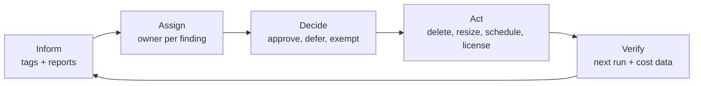

# FinOps playbook: from findings to savings

A report does not save money. People acting on it do. This playbook is the operating model around the toolkit: who owns a finding, who approves the change, and how to make the savings stick.

## The loop

It follows the FinOps Foundation phases (Inform, Optimize, Operate). Run it on a fixed cadence (every two weeks works well) rather than as a one-off clean-up.

## 1. Make ownership visible first

Without an owner, every finding ends in "who is this?". Start with `finops tags`.

| Tag | Why | Example rule |
| --- | --- | --- |
| `owner` | Who receives the finding. A team mailbox, not a person, so it survives reorganisations | `pattern: '^[^@\s]+@example\.com$'` |
| `cost-center` | Who pays. Maps to chargeback or showback | `pattern: '^CC-\d{4}$'` |
| `environment` | Drives the default action (dev can be scheduled, prod cannot) | `allowed: [dev, test, prod]` |
| `application` | Groups resources into something a product owner recognises | required, any value |

Practical sequence:

1. Run `finops tags --policy tag-policy.yaml --all -f csv` and share the compliance rate per subscription.
2. Fix tags at the **resource group** level first and set `inherit_from_resource_group: true`. It closes most gaps with little effort.
3. Enforce new resources with Azure Policy (`Require a tag on resource groups`, `Inherit a tag from the resource group`). Use `--fail-on-violations` in a pipeline to keep the rate from regressing.

## 2. Route each finding to its owner

| Finding | Default owner | Approver | Typical action |
| --- | --- | --- | --- |
| Unattached disk | `owner` tag of the disk or its resource group | Owner | Snapshot if needed, delete |
| Unassociated public IP | Network or platform team | Owner + network (DNS, allow-lists) | Delete |
| Orphaned NIC | Platform team | None (no data) | Delete |
| Empty App Service plan | Application owner | Owner | Delete or consolidate |
| Stopped, not deallocated VM | VM owner | Owner | Deallocate, or delete if unused |
| Idle or oversized VM | Application owner | Owner + change board for prod | Schedule, resize, decommission |
| Missing Hybrid Benefit | License manager | License manager | Enable after checking entitlement |

Export with `-f csv` (full resource IDs included) and load into the ticketing tool, one ticket per owner rather than one per resource.

## 3. Decide: approve, defer or exempt

Every finding gets one of three answers within the cycle:

- **Approve**: the action goes ahead in the next change window.
- **Defer**: a date is attached (for example, a disk kept until a migration ends).
- **Exempt**: the resource is tagged `finops-ignore=true` **plus** a `reason` tag. Exemptions are reviewed every quarter. The tag keeps the report clean without hiding the decision.

Safe deletion checklist:

- [ ] Owner confirmed in writing (ticket comment is enough).
- [ ] Snapshot or backup taken where data may matter, with a retention date.
- [ ] Resource locks and dependencies checked (`az lock list`, DNS records, firewall rules).
- [ ] Deleted in non-production first when a pattern repeats.

## 4. Shutdown windows for non-production

`finops schedule` is the highest-leverage change for dev and test, because those VMs are usually idle outside working hours.

1. Agree the default with teams: for example `19:00` local time, `mon-fri`.
2. Apply in dry-run and share the list: `finops schedule apply --time 19:00 --tz Europe/Paris --tag environment=dev`.
3. Apply for real with `--apply`.
4. Deploy the timer handler (see `examples/azure-function`) in dry-run, read the logs for a few days, then set `FINOPS_DRY_RUN=false`.
5. Give owners the escape hatch: `finops-shutdown-skip-until=YYYY-MM-DD` for release weeks. Re-applying a schedule keeps an existing opt-out.

Start-up is deliberately out of scope: people start VMs when they need them, and VMs nobody restarts are the next decommissioning candidates.

## 5. Rightsizing

- Use at least 14 days of data (30 for monthly workloads) and p95. Check the `insufficient-data` rows before trusting the rest.
- Resize non-production first. For production, go through change management and resize one instance of a scaled set before the others.
- `idle` verdicts are better candidates for a shutdown schedule or decommissioning than for a smaller size.
- Confirm the target size exists in the region and that quota allows it.

## 6. Commitments come last

Reservations and savings plans lock in a discount on what you **keep** running. Buy them after the clean-up, not before, or you commit to waste.

| Lever | Fits | Watch out for |
| --- | --- | --- |
| Azure Hybrid Benefit | Windows Server and SQL Server licenses with Software Assurance | License entitlement and count; document the mapping |
| Reserved Instances | Stable VM sizes and regions for 1 or 3 years | Rightsize first; use instance size flexibility |
| Savings plan for compute | Steady spend across changing sizes and services | Commitment is per hour; size it on the post-clean-up baseline |

Recommended order: **tags, then idle clean-up, then schedules, then rightsizing, then Hybrid Benefit, then commitments.**

## 7. Measure honestly

- Track savings as **avoided cost from a dated baseline**, per action, using Cost Management exports, not list prices.
- Record each executed action (resource ID, date, action, approver). The CSV output plus the ticket is enough.
- Re-run the toolkit after each cycle: a finding that comes back means the root cause (a pipeline, a template, a habit) is still there.

## Roles and permissions

| Activity | Role | Scope |
| --- | --- | --- |
| Run `idle`, `tags`, `hybrid-benefit` | `Reader` | Management group or subscriptions |
| Run `rightsize` | `Reader` + `Monitoring Reader` | Same |
| Run `schedule apply/remove/run --apply`, timer handler | `Virtual Machine Contributor` | Only the non-production scopes it manages |
| Delete, resize, enable Hybrid Benefit | Resource owner, through change management | Per resource |

The toolkit never deletes or resizes anything. Those changes stay with owners and their normal change process.
