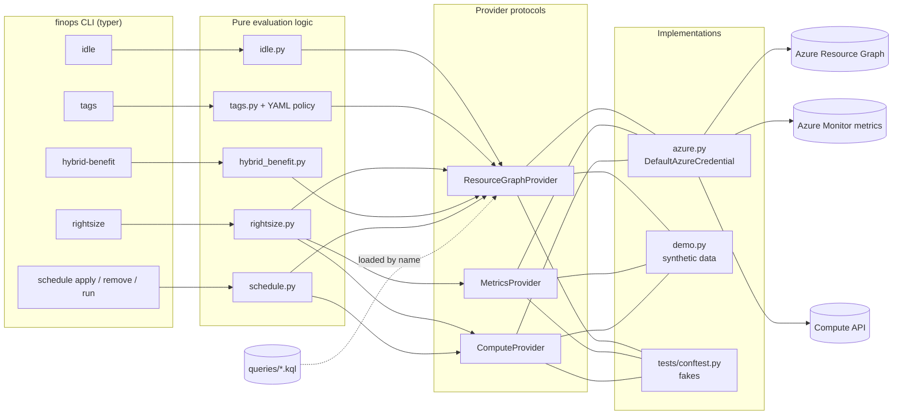
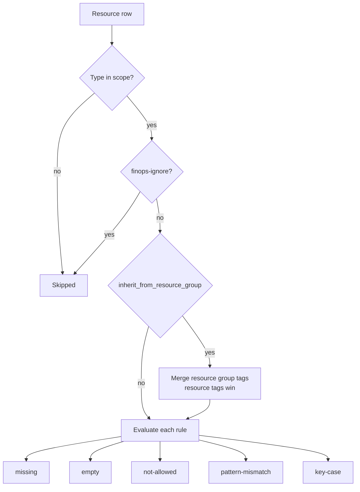
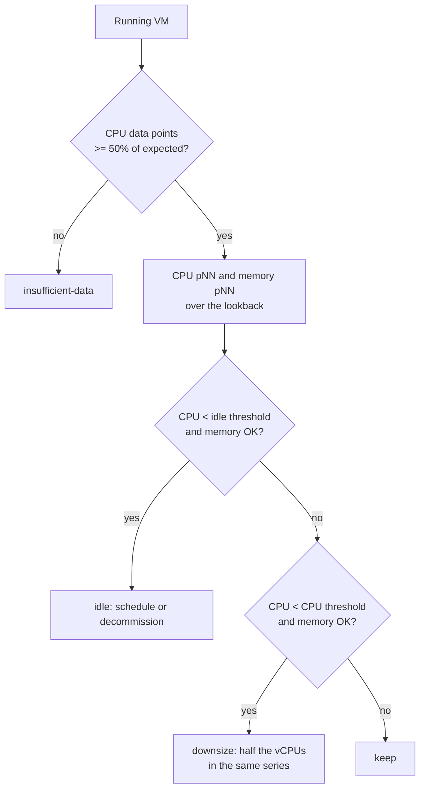
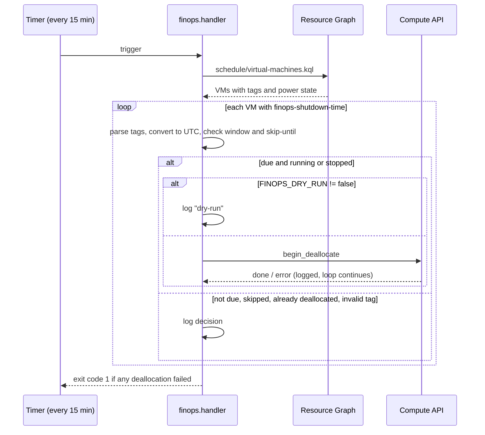

# How it works

The toolkit is a thin pipeline: **query** the estate, **evaluate** each record with plain Python rules, **render** a report, and, only for `schedule`, **act**. Everything that talks to Azure sits behind three small interfaces, so every rule is unit tested without a network connection.

## Architecture

| Interface | Azure implementation | Used by |
| --- | --- | --- |
| `ResourceGraphProvider.query(query, subscriptions)` | `azure-mgmt-resourcegraph`, paginated with `skip_token`, `objectArray` results | every command |
| `MetricsProvider.series(resource_id, metric, lookback, interval)` | `azure-monitor-query` `MetricsQueryClient.query_resource` | `rightsize` |
| `ComputeProvider.vm_memory_mb / set_vm_tags / deallocate_vm` | `azure-mgmt-compute` | `rightsize`, `schedule` |

Authentication is `DefaultAzureCredential`: Azure CLI login on a workstation, workload identity federation in CI, managed identity in a Function. The interactive browser flow is disabled so an unattended run fails fast instead of hanging.

## Why the split between KQL and Python

Resource Graph is excellent at **selecting** candidates across thousands of resources and many subscriptions in one call. It is a poor place for **business rules** that need tests and exceptions. So:

- `.kql` files select broadly (for example "every Windows VM and its `licenseType`").
- Python decides (for example "skip client OS images; skip VMs already on `Windows_Server`; skip anything tagged `finops-ignore=true`").

The KQL stays readable and portable to the portal, and the rules get unit tests.

## Command logic

### `idle`

Each category is one query plus a one-line description and a recommended action. Disk age comes from `LastOwnershipUpdateTime` (when the disk was last detached), falling back to `timeCreated`. `--min-age-days` hides freshly detached disks, which are often part of a running maintenance.

### `tags`

ARM tag names are case-insensitive, so by default `Owner` satisfies a rule for `owner`. Turn on `case_sensitive_keys` when downstream tooling (cost exports, scripts) is case-sensitive and the spelling matters.

### `rightsize`

- **Percentile, not average.** A nightly batch at 90% CPU is invisible in an average and obvious in p95.
- **Memory** is derived from the platform metric `Available Memory Bytes` and the size's memory from the Compute API. When the size is unknown the decision is CPU-only and the note says so.
- **Suggested size** halves the vCPU count within the same series (`Standard_D8s_v5` to `Standard_D4s_v5`). Constrained-core and irregular sizes get no automatic suggestion. Regional availability and quota are always for a human to confirm.

### `hybrid-benefit`

| Workload | Finding when | Not a finding |
| --- | --- | --- |
| Windows VM | `licenseType` empty | `Windows_Server`, `Windows_Client`, client OS images |
| SQL Server on VM | `sqlServerLicenseType = PAYG` | `AHUB`, `DR`, Developer and Express editions |
| SQL Database, elastic pool, Managed Instance | `licenseType = LicenseIncluded` | `BasePrice`, serverless (`GP_S_*`), DTU model |

### `schedule`

Details that matter in production:

- **Time zones** use the IANA database (`zoneinfo`). Comparisons happen in UTC, so the daylight-saving switch does not shift or double a shutdown.
- **Window** (`FINOPS_WINDOW_MINUTES`, default 30) must be at least the timer interval. A VM restarted by its owner after the window closes is left alone until the next day.
- **Midnight**: a 23:50 shutdown with a 30-minute window still fires at 00:10, because the previous day's occurrence is checked too.
- **Stopped is not off.** VMs in `PowerState/stopped` are deallocated as well, since they are still billed for compute.
- **One failure does not stop the run.** Each VM's error is captured in its result; the exit code reports that something failed.

## Testing approach

- Fakes in `tests/conftest.py` implement the three protocols in memory and record calls, so tests assert both the decision and the side effect (or its absence in dry-run).
- Pure functions (`percentile`, `suggest_smaller_size`, `parse_days`, `ShutdownSchedule.is_due`, `TagPolicy.evaluate`) are tested directly with edge cases: DST, midnight wrap, constrained sizes, case-insensitive keys.
- CLI tests run against `--demo` data and against injected fakes via `typer.testing.CliRunner`.
- The Azure adapter (`providers/azure.py`) is a thin mapping onto the SDKs and is excluded from coverage. It is exercised by real runs, not by mocks of the SDK.
